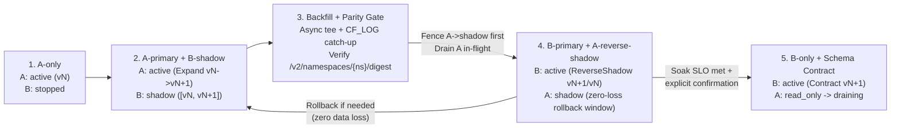

# Live A/B Deployment, Multi-Route Writing, and Schema Expand-Contract Guide

This guide documents Membus v2's four composable A/B storage substrate primitives and the
reference dual-slot local Compose and Kubernetes/GitOps topologies for zero-downtime live
deployments, shadow write-teeing, parity-gated cutovers, and zero-loss reverse-shadow rollbacks.

## 1. Architectural Boundary: Storage Resident vs. External Gateway

Membus remains a focused, transactional storage resident rather than a traffic router or load
balancer:

- **Layer 1 (External Delivery & Gateway Topology):** Traffic splitting, primary-first async
  write-teeing, bounded shadow queueing, `CF_LOG` delta backfill, and cutover orchestration live
  outside `membus` in an explicit `ab-router` gateway backed by isolated dual-slot infrastructure
  (`deploy/local/compose-ab.yaml` locally and `gitops/ab/` in Kubernetes/Flux).
- **Layer 2 (Four Minimal `membus` Substrate Primitives):** Each `membus` resident exposes four
  composable, strongly typed, auth-enforced primitives so external gateways and operators can
  execute deterministic A/B rollouts and schema migrations safely.

## 2. Four `membus` A/B Substrate Primitives

### Primitive 1 — Expand-Contract Multi-Version `CollectionCatalog`

`CollectionDescriptor` tracks:
- `compatible_versions: Vec<u32>` (sorted, deduplicated set of active compatible schema versions)
- `compatibility_mode: CompatibilityMode` (`Strict` | `ExpandDual` | `ReverseShadow`)
- `migration_state: MigrationState`:
  - `Active`
  - `Migrating { target_version, target_sha256, verified_through }`
  - `ReverseShadow { rollback_version, rollback_sha256, verified_through }`

All state transitions are CAS-fenced in `CF_META` and require `Permission::Admin`:

| Transition | HTTP Endpoint | Binary RPC | Behavior |
| --- | --- | --- | --- |
| Begin expand (`vN -> vN+1`) | `POST /v2/catalog/collections/{ns}/migrations/begin` | `Request::BeginMigration` | Moves `Active` -> `Migrating`, sets `ExpandDual` and `compatible_versions = [vN, vN+1]`. |
| Advance verification | `POST /v2/catalog/collections/{ns}/migrations/advance` | `Request::AdvanceMigrationVerification` | Monotonically advances `verified_through` during `Migrating` or `ReverseShadow`. |
| Enter reverse-shadow | `POST /v2/catalog/collections/{ns}/migrations/reverse-shadow` | `Request::EnterReverseShadow` | Promotes `schema_version = vN+1`, seals `rollback_version = vN` + `rollback_sha256`, sets `ReverseShadow` (`[vN, vN+1]`), archives `vN+1` immutably. |
| Instant rollback | `POST /v2/catalog/collections/{ns}/migrations/rollback` | `Request::RollbackMigration` | Re-verifies archived `vN` bytes against `rollback_sha256` and steps `schema_version` back to `vN` (`Active`, `Strict`, `[vN]`) without tripping forward-only version checks. |
| Contract window | `POST /v2/catalog/collections/{ns}/migrations/contract` | `Request::ContractMigration` | Closes `ReverseShadow` (or `Active` `ExpandDual`) down to single-version `Strict` `Active` (`[vN+1]`). |
| Direct commit / abort | `POST /v2/catalog/collections/{ns}/migrations/{commit,abort}` | `Request::{Commit,Abort}Migration` | Direct single-step commit to `Strict` `vN+1` or clean abort back to `Strict` `vN`. |

### Primitive 2 — First-Class Parity Digest Endpoint

- **HTTP:** `POST /v2/namespaces/{ns}/digest` (`Permission::Read`, wrapped in `query_timeout` + `max_active_snapshots`)
- **Binary:** `Request::NamespaceDigest { namespace, key_prefix, mode }` -> `Response::NamespaceDigest(NamespaceParityDigest)`
- **Modes:**
  - `"full"` (default): XOR of `SHA-256(key_len_be4 || key || value_sha256)` over an O(1) MVCC snapshot, transparently resolving `ColdRef` tombstones to their original `cold_sha256`. Shared with mesh anti-entropy (`src/storage/parity.rs`).
  - `"keys_only"`: XOR of `SHA-256(key_len_be4 || key)` for additive `vN+1` expand-phase key-set parity when values carry newly enriched fields.
- **Response:**
  `{ node_id, epoch, latest_seq, log_horizon_seq, entry_count, xor_digest_hex, catalog_schema_version }`

### Primitive 3 — Explicit Runtime Slot Role & Fencing Mode

Each resident persists `SlotRoleState { role, role_epoch }` atomically in `CF_META` (`sys:slot_role`)
and caches it lock-free in `ServerContext`:

- **Startup default:** `--slot-role <active|shadow|read_only|draining>` (default `active` on fresh
  storage; existing storage preserves its persisted `sys:slot_role` across restarts so a fenced
  slot never silently un-fences on reboot) and `--node-id <ID>`.
- **Observability:** Exposed as `slot_role` and `role_epoch` on `GET /v2/health` and binary
  `Request::HealthV2` (preserving 100% 7-field wire compatibility for legacy binary `Request::Health`).
- **CAS transition (`Permission::Admin`):** `POST /v2/admin/role` (and binary
  `Request::TransitionSlotRole`) accepting `{ expected_role, expected_role_epoch, new_role }` and
  monotonically incrementing `role_epoch`.
- **Enforcement across ALL HTTP, WebSocket, and binary mutation gates:**
  - `active`: Normal client writes allowed; if `X-Membus-Role-Epoch` is supplied and `< current`,
    rejected fail-closed with `409 Conflict` (`role_fenced`).
  - `shadow`: Reads, scans, streams, and parity digests allowed; normal client writes rejected with
    `409 Conflict` (`role_fenced`); accepts ONLY authenticated `/v2/replication/apply` (or binary
    `Request::ApplyReplicatedDelta`).
  - `read_only`: Rejects ALL writes including replicated apply with `409 Conflict` (`role_fenced`)
    while serving reads, parity digests, and `CF_LOG` catch-up scans.
  - `draining`: Rejects ALL writes including replicated apply with `503 Service Unavailable`
    (`role_fenced`) while serving reads, parity digests, and `CF_LOG` catch-up scans.

### Primitive 4 — Authenticated Replicated Apply & Transactional Write Idempotency

- **Replicated Delta Apply:**
  - `POST /v2/replication/apply` (and binary `Request::ApplyReplicatedDelta`), gated by
    `Permission::Write` (including secondary index and search op authorization).
  - Applies deterministic HLC LWW deltas (`ReplicationStamp`), carries `X-Membus-Route-Origin`,
    and rejects/no-ops echo loops whenever `delta.stamp.origin_node_id == local_node_id` or
    `X-Membus-Route-Origin` matches `local_node_id` / `router:<local_node_id>` (setting
    `echo_rejected: true` and `X-Membus-Echo-Loop: rejected` without mutating state).
- **Client Write Idempotency (`X-Membus-Idempotency-Key`):**
  - Optional header on HTTP `PUT /v2/kv/{ns}/{*key}`, `DELETE /v2/kv/{ns}/{*key}`, and
    `POST /v2/tx` (1..=256 non-control bytes).
  - Atomically persisted inside the same RocksDB `OptimisticTransaction` in `CF_META` with
    `{ request_fingerprint_sha256, committed_seq, committed_epoch, committed_version, committed_versions }`.
  - Replaying the same key with the same payload fingerprint returns the original `CommitResult`
    idempotently (`X-Membus-Idempotent-Replay: true`) without double-applying or advancing `seq`.
  - Reusing the same key with a DIFFERENT payload fingerprint fails closed with `409 Conflict`
    (`idempotency_conflict`).
  - Bounded retention (`StorageConfig::max_idempotency_entries`, default `16,384`) prunes the
    oldest dedup entries automatically in FIFO sequence order.

## 3. Five-Stage Live A/B Cutover & Reverse-Shadow Rollback Workflow

### Multi-Route Failure-Isolation Invariants (Gateway Layer)

1. **Primary Authority Isolation:** The external `ab-router` commits synchronously to the active
   Primary only and returns `200 OK` immediately. Any shadow timeout, error, or saturation never
   blocks or fails a primary commit.
2. **Bounded Async Shadow Queue + `parity_dirty` Gate:** On shadow saturation or outage, the router
   sheds shadow load, tracks dropped ops and lag, marks `parity_dirty = true` (hard-blocking
   Stage 3 -> 4 promotion), and catches up from Primary's `CF_LOG` upon recovery.
3. **Deterministic Convergence & Loop Guard:** Every shadowed mutation carries a Primary-anchored
   `ReplicationStamp`, `X-Membus-Route-Origin: router:<primary_slot>`, and deterministic client
   `X-Membus-Idempotency-Key` so retries across cutover boundaries never double-apply and
   live-tee + catch-up converge regardless of arrival order.

### Stage-by-Stage Operator Sequence

1. **Stage 1 (Expand Catalog on A & B):**
   - `POST /v2/catalog/collections/{ns}/migrations/begin` (`vN -> vN+1`, entering `ExpandDual`).
   - Clients write to Slot A (`active`) with `X-Membus-Idempotency-Key` and `X-Membus-Role-Epoch`.
2. **Stage 2 (Shadow Tee & Backfill to B):**
   - Slot B runs in `shadow` role (direct client writes rejected with `409 role_fenced`).
   - `ab-router` mirrors committed writes to Slot B via `POST /v2/replication/apply` with
     `X-Membus-Route-Origin: router:slot-a` and advances catalog verification via
     `POST /v2/catalog/collections/{ns}/migrations/advance`.
3. **Stage 3 (Parity Verification Gate):**
   - Call `POST /v2/namespaces/{ns}/digest` on both Slot A and Slot B (`"mode": "full"` for exact
     parity, or `"mode": "keys_only"` during additive `vN+1` enrichment).
   - Require `parity_dirty == false`, identical `entry_count`, and identical `xor_digest_hex`.
4. **Stage 4 (Fenced Cutover & Reverse-Shadow Rollback Window):**
   - Fence Slot A FIRST: `POST /v2/admin/role` (`active -> shadow`, incrementing `role_epoch`).
   - Wait for Slot A in-flight writes to drain and verify final digest parity.
   - Promote Slot B: `POST /v2/admin/role` (`shadow -> active`, incrementing `role_epoch`).
   - Transition Slot B catalog into reverse-shadow:
     `POST /v2/catalog/collections/{ns}/migrations/reverse-shadow`.
   - Reverse-mirror new Slot B writes back to Slot A (`shadow`) via `/v2/replication/apply`.
   - **Zero-Loss Rollback (if regression detected during soak):**
     1. Fence Slot B (`active -> shadow`) and verify final parity B -> A.
     2. Run `POST /v2/catalog/collections/{ns}/migrations/rollback` on Slot B (`vN+1 -> vN`).
     3. Promote Slot A back (`shadow -> active`) with zero data loss.
5. **Stage 5 (Contract & Drain):**
   - Once soak SLOs pass and rollback window closes:
     1. Run `POST /v2/catalog/collections/{ns}/migrations/contract` on Slot B (`Strict` `vN+1`).
     2. Transition Slot A `shadow -> read_only` (`409 role_fenced` on all writes) and then
        `read_only -> draining` (`503 role_fenced` on all writes) before decommissioning Slot A.

## 4. Reference Deployment Topologies

- **Local Dual-Slot Compose (`deploy/local/compose-ab.yaml`):**
  - Isolates `membus-slot-a` (`membus_slot_a_net`, `internal: true`, `--slot-role active`) and
    `membus-slot-b` (`membus_slot_b_net`, `internal: true`, `--slot-role shadow`) with independent
    named volumes and zero host ports behind a parameterized `ab-router` loopback surface.
- **Kubernetes + Flux Kustomize (`gitops/ab/`):**
  - Independent `Deployment`, `Service`, and `PersistentVolumeClaim` per slot (`slot-a.yaml`,
    `slot-b.yaml`), non-root UID/GID `10001:10001`, `0440` TLS/auth secret permissions,
    default-deny `NetworkPolicy` (`networkpolicy.yaml`) permitting ingress only from `ab-router`
    on `8443/TCP`, and dual-slot immutable `@sha256:` image pinning (`kustomization.yaml`) so
    registry garbage collection retains both active and rollback-window images simultaneously.
